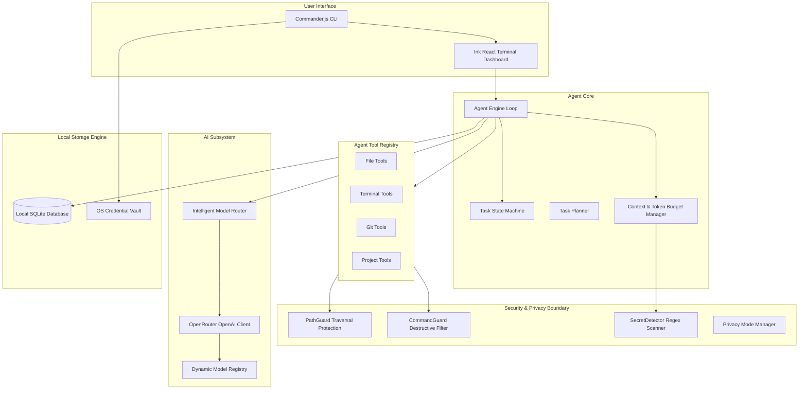

# Veloura Code Architecture

This document describes the internal software architecture, subsystems, state machines, and data models of **Veloura Code**.

---

## 1. System Design Goals

1. **Terminal-Native Autonomy**: End-to-end execution of coding tasks directly inside local project directories.
2. **Local-First Privacy**: Never transmit conversation history, audit records, or project memories to cloud databases.
3. **Resilience & Graceful Degradation**: Dynamic model discovery, task categorization, and multi-tier model fallback on OpenRouter rate limits (HTTP 429) or timeouts.
4. **Surgical Precision**: Minimal diff-based code modifications with SHA-256 integrity verification to prevent race conditions.
5. **Defense-in-Depth**: Path traversal prevention, dangerous command interception, and automated secret redaction.

---

## 2. Component Topology



---

## 3. Subsystem Breakdown

### 3.1 Autonomous Agent Engine (`src/agent/engine.ts`)
The engine executes an iterative feedback loop:
1. **Initialize Task**: Loads or creates a conversation in SQLite; maps current project structure.
2. **Auto-Checkpoint**: Creates a Git commit checkpoint (or SQLite file snapshot) before modifying code.
3. **Context Construction**: Formats the system prompt, directory tree, instructions, and user task.
4. **Model Selection**: Queries `ModelRouter` to classify the task and choose the best free model.
5. **Execution Loop**:
   - Sends sanitized prompt history to OpenRouter.
   - If tool calls are returned, dispatches them sequentially to registered tools.
   - Appends tool outputs as `tool` role messages.
   - If no tool calls are returned, triggers verification checks (tests or build).
   - If verification fails, re-prompts the model with the failure logs to self-heal.
   - Completes task when all tests pass and model generates final summary.

### 3.2 Task State Machine (`src/agent/state.ts`)
Tasks move through strict state transitions:

```
[Idle]
  │
  ▼
[Planning] ────────► [Executing] ◄──────► [WaitingForApproval]
                         │
                         ▼
                     [Verifying]
                         │
        ┌────────────────┼────────────────┐
        ▼                ▼                ▼
   [Completed]        [Failed]       [Cancelled]
```

### 3.3 File Editing & Patcher (`src/fs/editor.ts`, `src/fs/patcher.ts`)
- **Read-Before-Edit**: Enforces reading files and records SHA-256 hashes.
- **Concurrency Check**: Rejects edits if the source file changed on disk between read and edit.
- **Targeted Replacements**: Uses line-normalized fuzzy block matching to replace exact code chunks without modifying surrounding code.
- **Unified Diff Generation**: Uses `jsdiff` to create standard unified diff patches and logs them in SQLite.

### 3.4 Terminal Execution & Command Guard (`src/terminal/runner.ts`, `src/security/commandGuard.ts`)
- Spawns platform-appropriate shells (`cmd.exe` on Windows, `/bin/sh` on Unix).
- Intercepts destructive patterns:
  - Critical/Blocked: `format`, `diskpart`, `mkfs`, `curl ... | bash`.
  - High-Risk (Requires Approval): `rm -rf`, `del /s`, `git push`, `git reset --hard`, `sudo`, global npm/pip installs.
- Limits captured stdout/stderr buffers to 50KB to preserve token limits.
- Supports timeout kills and Ctrl+C cancellation tree-killing child processes.

### 3.5 Database Schema (`src/db/schema.ts`)
SQLite with Write-Ahead Logging (WAL) mode:
- `conversations`: Conversation sessions and project paths.
- `messages`: System, user, assistant, and tool messages with token counts.
- `tasks`: Task descriptions, state machine states, and iteration counts.
- `tool_executions`: Tool inputs, outputs, errors, and execution latencies.
- `file_changes`: File modification diffs, old/new SHA-256 hashes, and timestamps.
- `checkpoints`: Git commit hashes or snapshot references for rollback.
- `project_memory`: Project-specific architectural notes and key-values.
- `model_metrics`: Historical latency, success rate, and error logs per model.
